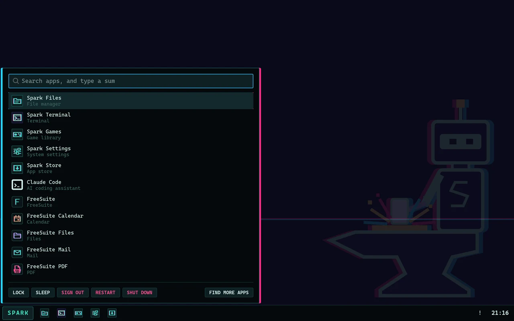
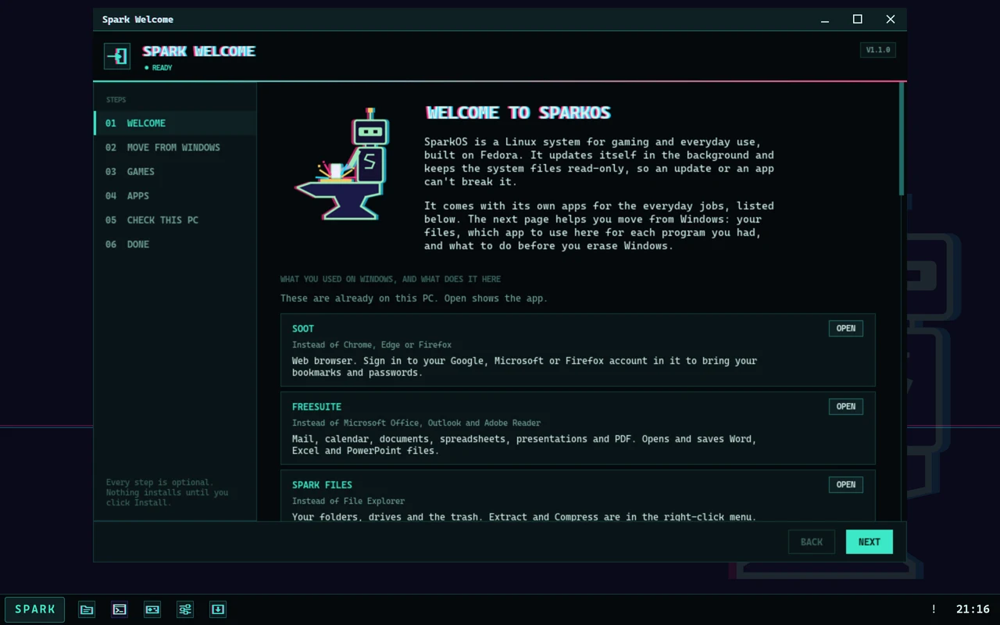
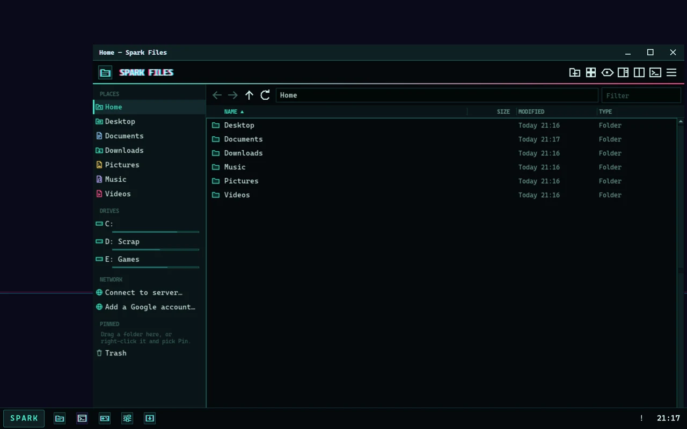
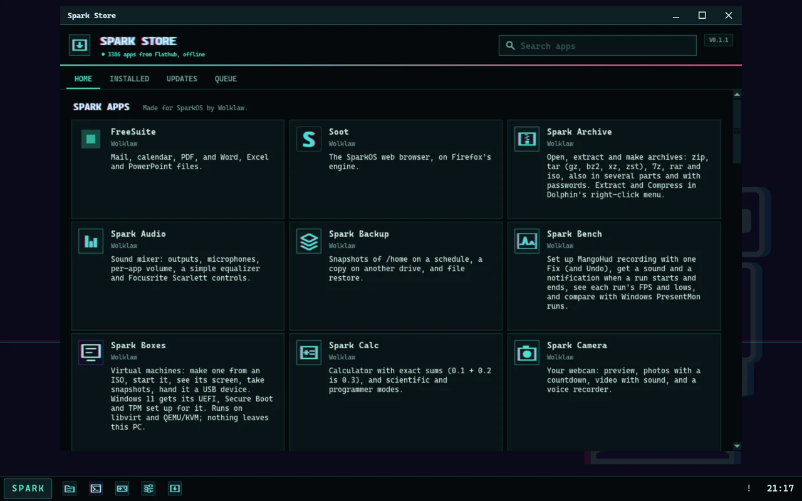

# SparkOS &nbsp; [](https://github.com/Wolklaw/sparkos/actions/workflows/build.yml)

A Linux desktop for gaming and everyday work. It starts from Fedora's atomic base image (base-atomic, which has no desktop) and adds its own desktop: the Spark compositor, Spark Shell and the Spark apps. It is built from one [Containerfile](Containerfile) ([how it's built](docs/building.md)).

Status: early. It is the daily system on one real PC (AMD, dual boot next to Windows 11, since 21 Nov 2026). Since 25 Nov 2026 that PC runs the Spark desktop session every day. From the 26 Nov 2026 image, the base has no desktop of its own and KDE, Plasma and KWin are not installed at all. CI boots every build in a VM ([boot-test](.github/workflows/boot-test.yml)) and checks the system name, the signed image, the preinstalled apps and the default apps. Expect rough edges, and keep Windows. The roadmap is in [PLAN.md](PLAN.md).

On that PC, Marvel's Spider-Man 2 runs **18% faster on SparkOS than on Windows 11**: 92.4 vs 78.6 FPS on average, with 1% lows of 62.6 vs 48.4. Both used the same settings, with HDR on. The method and the limits are in [docs/benchmarks.md](docs/benchmarks.md). This was measured on the Plasma session, before the Spark compositor.

## The desktop



| | |
|---|---|
|  |  |
|  | |

Screenshots from the Spark session, 25 Nov 2026, in a fresh user folder.

SparkOS draws its own desktop. There is no KDE, Plasma or KWin in the image: the base (Fedora base-atomic) has no desktop, and the last build step ([sparkos-no-kde.sh](files/scripts/sparkos-no-kde.sh)) fails the build if a KDE package gets pulled in.

- **Spark Greeter** is the login screen: greetd runs it on the Spark compositor. If it fails to start a few times in a row, greetd switches to a text login by itself, and `spark greeter enable` brings it back.
- **Spark** (`spark-wl`) is the only session:
  - **Spark compositor**: a Wayland compositor on wlroots, written in C ([source](files/spark-compositor)). It draws the title bars and handles snapping and maximizing, HDR, workspaces (Super+Ctrl+Left/Right) and optional tiling per workspace (Super+Ctrl+T). Alt+Tab opens a window switcher, and the Windows 7 window keys work (Super+arrows, Super+D, Super+E). The volume and mute keys work, and the screen stays on while a video or game asks for it. X11 apps run through XWayland.
  - **Spark Shell**: the panel, task list, tray, notifications, the Spark menu (Win7-style, above the SPARK button), wallpaper, volume display and lock screen, all in GTK 4 ([source](files/spark-shell)). Old X11 tray icons work too, so Wine and Proton apps such as Battle.net show theirs in the tray. Task buttons and tray icons can be dragged into a new order, and Spark Connect's server status can sit in the tray of any screen (off by default, in Spark Settings > Appearance > Taskbar).
  - **Spark's own pieces for the rest**: password prompts (polkit agent), Open and Save dialogs for every app (a Spark Files portal), a Spark portal backend for settings, inhibit, notifications and print (no GTK portal), screenshots and screen sharing through the wlroots portal with a Spark picker for a whole screen or one window, the foreground booster (the focused app gets VRAM protection and a bigger CPU share), and the startup sound.

Not Spark yet:
- Saved passwords go in Spark Secrets, a Secret Service made for SparkOS, so apps that use libsecret keep working. It keeps them encrypted in `~/.local/share/spark-secrets/` and your login password unlocks it at sign-in (if it cannot, it asks once). `spark-secrets --import-gnome-keyring` copies a GNOME Keyring file in; passwords saved in KWallet do not move over. SSH keys are held by openssh's `ssh-agent`.
- Third-party apps that ask for an icon SparkOS has not drawn get Breeze Dark's. Spark's own apps and the shell use only SparkOS icons, and the cursors are SparkOS's own. Breeze Dark is image files only; no KDE software is installed.

Not tried on real hardware yet: VRR, tearing and direct scanout are written but not tried on a GPU, and the Nvidia image hasn't been tried on a real Nvidia PC. Night light is not planned.

## What's in it

SparkOS ships only its own apps:
- **Preinstalled**: Soot, FreeSuite and 30 Spark apps and desktop parts. They come with the system and update with it.
- **Optional**: 6 more Spark apps, which Spark Store installs for your account in one click.

Everything else, Steam included, installs from Spark Store, or by double-clicking a downloaded `.exe`, `.msi`, `.AppImage` or `.rpm`. The versions below are the current ones.

### Browser and office

| App | Version | What it does | |
|---|---|---|---|
| **Soot** | - | The default browser. It runs on Firefox's engine and blocks ads and trackers. You always get its latest release. | [repo](https://github.com/Wolklaw/Soot) |
| **FreeSuite** | - | Mail, calendar and PDF, plus Word, Excel, PowerPoint and OpenDocument files. You always get its latest release. | [repo](https://github.com/Wolklaw/freesuite-releases) |

### The desktop

| App | Version | What it does | |
|---|---|---|---|
| **Spark compositor** | - | The window manager and display server of the Spark session: title bars, snapping, the Alt+Tab switcher, keyboard shortcuts, monitors from a config file. | [source](files/spark-compositor) |
| **Spark Shell** | 0.1.0 | The panel, tray, notifications, Spark menu, wallpaper, volume display and lock screen. | [source](files/spark-shell) |
| **Spark Session** | 0.1.0 | The login screen (Spark Greeter, on greetd), the session start-up, and the polkit agent for password prompts. | [source](files/spark-session) |
| **Spark Files** | 1.3.0 | The file manager. It has tabs and a split view, copies in the background, search, thumbnails, the Trash, your Windows drives and network places (SSH, cloud with rclone). It also provides the Open and Save dialogs for other apps. | [source](files/spark-files) |
| **Spark Terminal** | 1.1.0 | Tabs, split panes, search in the scrollback and clickable links. Opens with Ctrl+Alt+T. | [source](files/spark-terminal) |
| **Spark Settings** | 1.1.0 | Displays, sound, network, Bluetooth, power, default apps, date and language, printers, startup and shortcuts. | [source](files/spark-settings) |
| **Spark Store** | 0.1.1 | The Spark apps first, then every app on Flathub. It tells you in plain words what each one can access. One click installs. | [source](files/spark-store) |
| **Spark Update** | 1.2.2 | Gets the next version ready in the background and tells you when a restart will start it. It shows what changed and can roll back. | [source](files/spark-update) |
| **Spark Welcome** | 1.1.0 | Opens once, at first login. It shows the Spark app for each Windows program, copies your files, fonts and Steam games from Windows, suggests apps to add and checks the PC. | [source](files/spark-welcome) |
| **Spark Tray** | 0.1.0 | Tray icons for network, Bluetooth, power, printers and volume, each with a small popup. | [source](files/spark-tray) |

### Everyday

| App | Version | What it does | |
|---|---|---|---|
| **Spark Snip** | 1.3.1 | Screenshots with Print, then an annotate step (arrows, text, pixelate, crop). It also copies text off the screen (English and French) and records the screen. | [source](files/spark-snip) |
| **Spark Media** | 1.2.0 | Photos (including camera RAW and HEIC), videos with subtitles, and a music library with playlists and media keys. | [source](files/spark-media) |
| **Spark Edit** | 1.0.2 | Text and code, with tabs, find and replace and syntax colours. Files keep their own encoding, and unsaved tabs come back. | [source](files/spark-edit) |
| **Spark Calc** | 1.0.1 | Exact sums (0.1 + 0.2 is 0.3), with scientific and programmer modes and a history. | [source](files/spark-calc) |
| **Spark Fonts** | 0.1.0 | Shows, installs and removes fonts, with previews, characters and licence details. It finds the fonts on a Windows drive. | [source](files/spark-fonts) |
| **Spark Archive** | 1.2.1 | Opens and makes zip, 7z, tar, rar and iso, including multi-part archives and passwords. Extract and Compress are on the right-click menu. | [source](files/spark-archive) |
| **Spark Scan** | 1.1.0 | Scans from the glass or the feeder and straightens pages. It saves one PDF (searchable if you want) or one image per page. | [source](files/spark-scan) |
| **Spark Notes** | 0.1.1 | Quick notes saved as plain files. Also clipboard history on Super+V, with search, pins and a pause. No account. | [source](files/spark-notes) |
| **Spark Emoji** | 0.1.0 | Emoji and symbols on Super+. (full stop). Search in English or French, with recents and skin tones, plus arrows, maths and accented letters. | [source](files/spark-emoji) |
| **Spark Boxes** | 0.1.0 | Virtual machines. Make one from an ISO, start it, see its screen, take snapshots and pass USB devices through. It sets up UEFI, Secure Boot and a TPM for Windows 11. It runs on libvirt and KVM (run `spark virt setup` first). | [source](files/spark-boxes) |
| **Spark Audio** | 0.1.0 | The sound mixer: outputs, microphones with a test, volume per app, and a simple equalizer. | [source](files/spark-audio) |

### Looking after the PC

| App | Version | What it does | |
|---|---|---|---|
| **Spark Monitor** | 1.1.1 | The task manager, on Ctrl+Shift+Esc. It groups processes by app and has End task, live graphs, startup apps, the live system log and a hardware summary you can copy. | [source](files/spark-monitor) |
| **Spark Disks** | 0.1.0 | Drives and partitions. Mount, format and resize, check drive health (SMART) and write an image to a USB stick. | [source](files/spark-disks) |
| **Spark Backup** | 0.1.2 | Takes snapshots of your home folder on a schedule, keeps a copy on another drive and restores files. Not tried on a real PC yet. | [source](files/spark-backup) |
| **Spark Firewall** | 0.1.2 | The firewall in plain words. Turn it on or off, open what a game or app needs, and set a zone for each network. | [source](files/spark-firewall) |

### Games, hardware and phone

| App | Version | What it does | |
|---|---|---|---|
| **Spark Games** | 0.3.5 | One library for every game. Sign in to Epic, GOG and Amazon here, add Battle.net, EA, Ubisoft and Rockstar, and see Steam, Lutris, itch and more. It has controller and big-screen modes. | [source](files/spark-games) |
| **Spark Controller** | 1.2.0 | Fan curves, RGB lighting on every part, game controllers with a live button tester, and firmware updates. | [source](files/spark-controller) |
| **Spark Run** | 1.0.1 | Runs Windows programs on Wine, or installs them as apps with their own menu entry. Wine downloads the first time you use it. | [source](files/spark-run) |
| **Spark Link** | 1.1.0 | Your phone over the local network: links, files, notifications, battery, find my phone, the last screenshot, and an optional shared clipboard. Pairs with Soot for Android. | [source](files/spark-link) |

### Optional, from Spark Store

| App | Version | What it does | |
|---|---|---|---|
| **Spark Bench** | 0.1.0 | Game benchmarks. Sets up MangoHud recording in one click, plays a sound when a run starts and ends, and shows FPS and lows per run, compared with Windows. | [source](files/spark-bench) |
| **Spark Space** | 1.0.0 | Shows what takes the space on your drives: a map of every folder, the largest files, and safe moves to the Trash. | [source](files/spark-space) |
| **Spark Connect** | 0.2.0 | Home servers on one screen, fixed over SSH: services, health, tunnel, failover and websites. | [source](files/spark-connect) |
| **Spark Clock** | 0.2.0 | Alarms, timers, a stopwatch and world clocks. Alarms ring with the window closed and after a restart. | [source](files/spark-clock) |
| **Spark Clips** | 0.1.0 | Instant replay for games. It keeps the last seconds on the GPU, Super+Alt+G saves them as a clip, and it has a library and lossless trimming. | [source](files/spark-clips) |
| **Spark Camera** | 0.1.0 | Your webcam: a preview, photos with a countdown, video with sound, and a voice recorder. | [source](files/spark-camera) |

## How big it is

Lines of code written for SparkOS, not counting blank lines, other people's code or generated files. Counted 25 Nov 2026.

| Part | Lines |
|---|---:|
| The Spark desktop, which replaces KDE, Plasma and KWin (compositor, shell, sign-in screen, launcher, session, tray) | 17,200 |
| The Spark apps | 180,600 |
| The image, installer, build and CI | 12,400 |
| **SparkOS repository** | **210,200** |
| Soot (desktop and Android) | 7,900 |
| FreeSuite | 18,500 |
| **Everything** | **236,600** |

About 44,000 of the SparkOS lines are tests. Most of the code is Python (190,000 lines). The compositor is C (3,800). There are also about 20,000 lines of docs, config and units.

## Every feature

**Updates and safety**

- The whole system updates as one image, built every day from the latest Fedora base-atomic.
- Every image is signed with cosign, and a SparkOS PC only accepts an update signed with SparkOS's key.
- Every build is installed and booted in a virtual machine on GitHub. The test checks the system and the signature, and opens every app.
- Updates download in the background and wait while a game runs, on a metered connection or on a low battery. The PC never restarts on its own.
- Roll back in one click in Spark Update, or pick the previous version in the boot menu. After three failed boots, it goes back by itself.
- Every change you will notice gets release notes in plain words, in English and French.

**Coming from Windows**

- Windows keys: Ctrl+Shift+Esc for the task manager, Print for a screenshot, Super+V for clipboard history, Super+. for emoji, Ctrl+Alt+T for a terminal, Alt+Tab, Super+arrows to snap, Super+D for the desktop, Super+E for files.
- Caps Lock turns on when you press it, like Windows, not when you release it.
- Double-click a downloaded `.exe`, `.msi`, `.AppImage` or `.rpm` to install it. A `.deb` gets a plain explanation and a way to the Store.
- Spark Welcome copies your files, fonts and Steam games from a Windows drive, and your Windows drives show in Spark Files.
- Windows stays. SparkOS installs next to it, and you pick one at power-on.

**Games**

- gamescope, MangoHud, GameMode and umu-launcher come with it.
- SparkOS builds extra drivers for each kernel: Xbox wireless adapters, racing wheels, AMD CPU power sensors, virtual cameras and disc drives.
- It adds device rules for controllers and wheels, and tunes memory, network, zram and disk schedulers for games. A VRAM booster is included.
- Full video decoding and encoding on the graphics card, from RPM Fusion, for recording and streaming.
- Steam, Heroic and Lutris install from the Store in a click, and Spark Games puts their games in one library.

**The desktop**

- It has its own look: dark indigo with a mint accent, its own icons, wallpaper, boot splash and startup sound.
- Its own compositor and shell (above). KDE's desktop and tools are replaced by Spark apps: the file manager, terminal, app menu, task manager, screenshot tool, clipboard, emoji picker, firewall tool, polkit agent, notifications and tray.
- No preinstalled apps from other companies. Fedora's apps are removed, and each one can come back from the Store.
- The Spark apps follow the system language, English or Quebec French.

**Everything else**

- Driverless printing, scanning and Bluetooth, from Fedora.
- Flathub for every other app, installed per user by the Store.
- For developers: Homebrew, `sparkos-dev-setup` for Node, Python, GitHub CLI and JDK 17, and Claude Code one click away ([docs](docs/claude-code.md)).
- VIA keyboard setup and Androidbox work without extra steps.
- The source can be read on GitHub: the build file, every script and every Spark app.

**Platform (from Fedora)**

- From Fedora: the kernel and current Mesa drivers, systemd, PipeWire, NetworkManager, CUPS driverless printing, SANE scanning and Bluetooth. From wlroots: the compositor's base. From RPM Fusion: full video decoding and encoding.
- From GNOME: pinentry-gnome3 for passphrase prompts. From KDE: Breeze's icon and cursor artwork only.
- Not in the image: all of KDE (Plasma, KWin, Plasma Login Manager, Dolphin, Konsole, Ark, KWallet, System Settings, Discover, KDE Connect and the KDE Frameworks; SparkOS was built on Fedora Kinoite until 26 Nov 2026), plus Firefox, GNOME Disks, Btrfs Assistant and firewall-config. Spark apps replace them: Spark Files, Terminal, Archive, Settings, Store, Link, Disks and Firewall. Flathub apps made with KDE still install and run; they bring their own libraries.

Soot, FreeSuite and the Spark apps are new on Linux. The boot test checks them on every build. It opens each one from the app menu on a SparkOS desktop in a VM and takes a screenshot. On a real PC they have had only a few days of use, the Spark session one day, and Spark Backup none yet.

More docs:
- Installing next to Windows: [docs/install.md](docs/install.md).
- What works, what's replaced and what doesn't run: [docs/switching.md](docs/switching.md).
- Installing apps the Windows way, from a store or by double-clicking a download: [docs/installing-apps.md](docs/installing-apps.md).

Games with kernel-level anti-cheat don't run on Linux. These include Valorant, Fortnite and recent Call of Duty. Check your games on [ProtonDB](https://www.protondb.com) and [Are We Anti-Cheat Yet](https://areweanticheatyet.com).

## Supported hardware

| Part | Works | Notes |
|---|---|---|
| CPU | Any 64-bit AMD or Intel CPU | AMD Ryzen also gets two extra modules: zenergy (power readings) and ryzen_smu. |
| AMD graphics | Radeon HD 7000 (GCN) and newer, up to RX 9000 | Full Vulkan, so Steam and Proton games run. Older Radeon cards (HD 6000 and before) show the desktop but can't run Vulkan games. |
| Intel graphics | 5th gen Core (Broadwell) and newer, Arc A and B series | Older Intel graphics show the desktop, with weaker or no Vulkan. |
| Nvidia graphics | GTX 16, RTX 20, 30, 40 and 50 series, with the `sparkos-nvidia` image | Not yet tried on a real Nvidia PC. GTX 10 and older only get the open nouveau driver: the desktop works, games mostly don't. |
| Firmware | 64-bit UEFI | No legacy BIOS boot. |
| Secure Boot | On or off | SparkOS starts with Secure Boot on: the kernel is Fedora's, signed by Fedora. SparkOS's extra kernel modules (Xbox wireless adapters, racing wheels, CPU power sensors, virtual webcam, virtual disc drive and, in the Nvidia image, the Nvidia driver) are signed with SparkOS's own key, and with Secure Boot on they load only after you enroll that key once with `spark secureboot enroll` ([how](docs/install.md)). On the Nvidia image, until the key is enrolled the desktop may not start (nouveau is turned off there), so enroll right after installing or turn Secure Boot off. The modules are signed, but no PC has enrolled the key yet. With Secure Boot off, none of this is needed. |
| Disk | 100 GB free, 200 GB or more for games | Next to Windows, on any drive. |

Tested on real hardware so far: one PC, with a Ryzen 7 7800X3D and a Radeon RX 6800 XT. Everything else in the table comes from what the drivers in the image support, not from tests. If SparkOS runs, or fails, on your hardware, an [issue](https://github.com/Wolklaw/sparkos/issues) helps.

## Install next to Windows

1. Download every file of the [installer release](https://github.com/Wolklaw/sparkos/releases/tag/installer). The ISO comes in parts under 2 GB.
2. Join them with `join-iso.cmd` (Windows) or `join-iso.sh` (Linux).
3. Write the ISO to a USB stick.
4. Follow [docs/install.md](docs/install.md).

Windows stays, and you pick the system at power-on.

CI builds the installer every Monday, boots it in a VM and installs it next to a Windows disk there ([installer-install-test](.github/workflows/installer-install-test.yml)). So far it has been installed on one real PC. There are two images: `sparkos` for AMD and Intel graphics, and `sparkos-nvidia` for Nvidia GTX 16, RTX 20 and newer. The Nvidia one hasn't been tried on a real Nvidia PC yet.

## Switching from another Fedora atomic desktop

SparkOS was built on [Bazzite](https://bazzite.gg) until 23 Nov 2026 then on Fedora Kinoite until 26 Nov 2026, and is now built on Fedora's base-atomic, with no desktop but its own ([why and what changed](docs/fedora-base.md)). From Bazzite, Kinoite or another Fedora atomic desktop:

1. Switch to the unsigned SparkOS image first. This installs the SparkOS signing key:
   ```
   rpm-ostree rebase ostree-unverified-registry:ghcr.io/wolklaw/sparkos:latest
   systemctl reboot
   ```
2. Switch to the signed image:
   ```
   rpm-ostree rebase ostree-image-signed:docker://ghcr.io/wolklaw/sparkos:latest
   systemctl reboot
   ```

Updates arrive automatically. A new image is built every day from the latest Fedora base-atomic. If an update breaks something, choose the previous entry in the boot menu.

## Verify

Images are signed with [cosign](https://github.com/sigstore/cosign):

```
cosign verify --key cosign.pub ghcr.io/wolklaw/sparkos
```

## Contributing

SparkOS is mine, and I decide what goes in, but anyone can propose a change. Fork the repository, make the change on a branch and open a pull request. If I merge it, it ships in the next daily image to every SparkOS PC. Bug reports and hardware reports (what works and what doesn't on your PC) are just as useful: open an [issue](https://github.com/Wolklaw/sparkos/issues).

How to build, test and send a change, and what I'll merge: [CONTRIBUTING.md](CONTRIBUTING.md). The license lets you fork and change the code to propose it here; a contribution you send comes under the terms in [LICENSE](LICENSE).

## License

SparkOS is source-available, not open source. You can read the code here, and download, install and use the official SparkOS installer and images. You can fork it and change it to propose a pull request here. Other copying, modifying, redistributing or building your own versions needs written permission. See [LICENSE](LICENSE). Parts made by others keep their own licenses: see [THIRD-PARTY.md](THIRD-PARTY.md).
