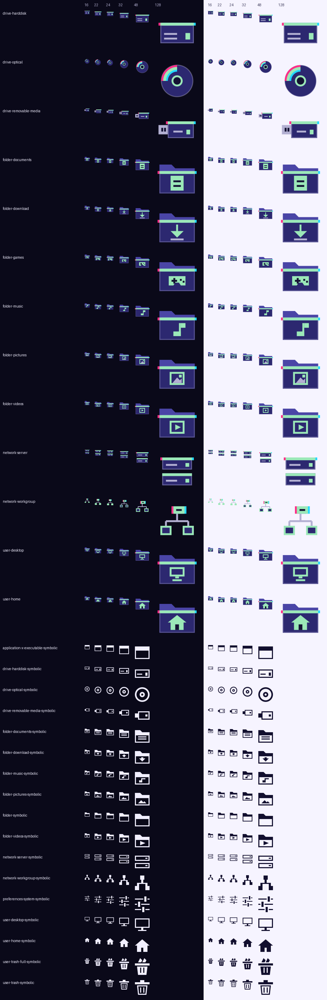
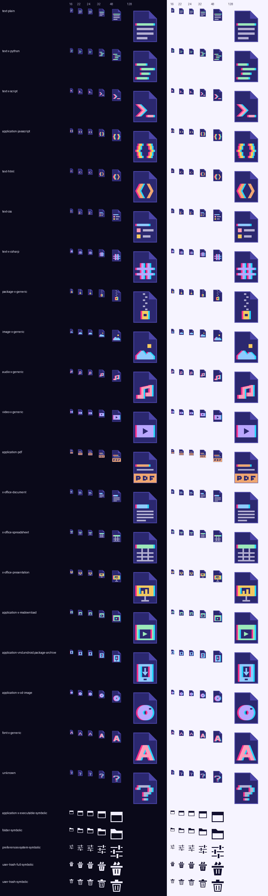

# SparkOS icons

SparkOS has its own icon theme, `SparkOS`, in [files/sparkos-icons/SparkOS](../files/sparkos-icons/SparkOS).
It **inherits Breeze Dark**: any icon it doesn't draw yet comes from Breeze, so nothing goes missing
while it grows. It is drawn in four batches ([brief](../briefs/sparkos-icons.md)); this page is the
style sheet every batch follows.

## What's drawn

| Batch | Icons | Status |
|---|---|---|
| 1. Theme and the taskbar | System Settings (`preferences-system`, `systemsettings`), Steam (`steam`, `com.valvesoftware.Steam`), generic app (`application-x-executable`, `application-default-icon`), folder (`folder`, `inode-directory`), Trash (`user-trash`, `user-trash-full`); symbolic versions of all but Steam | Done |
| 2. Folders and places | Home, Desktop, Documents, Downloads, Music, Pictures, Videos, Games, Windows drives, network, removable drives, the sidebar | Done (see "Batch 2" below) |
| 3. File types | text, code, archives, images, audio, video, PDF, office, .exe/.msi, APK, ISO, fonts, generic file (`unknown`) | Done: 20 icons and about 420 names, see Batch 3 below |
| 4. Tray and status | network, Bluetooth, volume, battery, updates, notifications, Caps Lock | Not started |

The Spark apps, Soot, FreeSuite and Nova keep the icons they ship; the theme never draws over them.

## Where it is set

- The image installs it at `/usr/share/icons/SparkOS` ([sparkos-icons.sh](../files/scripts/sparkos-icons.sh),
  just before `sparkos-theme.sh`).
- `/etc/xdg/kdeglobals` (`[Icons] Theme=SparkOS`) makes it the default for everyone who hasn't picked
  a theme, new users and existing ones. The SparkOS look-and-feel package says SparkOS too, so applying
  the SparkOS look keeps it.
- [sparkos-icons-default](../files/system/usr/libexec/sparkos-icons-default) runs once per user at
  sign-in: if the user's own settings say `breeze-dark` (the old SparkOS default, written there when the
  SparkOS look was applied), it removes that line so the SparkOS default applies from the next sign-in.
  Any other choice is left alone, and it never runs a second time.
- To go back: System Settings > Colors & Themes > Icons > Breeze Dark.

## Grid and sizes

| Folder | Grid | Used for |
|---|---|---|
| `scalable/` | 48 x 48 viewBox | 32 px and up (the taskbar at its default size, menus, file views) |
| `22/` | 22 x 22 | toolbars, the panel at small sizes |
| `24/` | the 22 px drawing with a 1 px margin (`viewBox="-1 -1 24 24"`) | 24 px requests, kept sharp |
| `16/` | 16 x 16 | lists, the file manager sidebar, menus |
| `symbolic/` | 16 x 16, one colour | toolbars and the tray (`-symbolic` names) |

- Small sizes are drawn again, not shrunk: fewer parts (two sliders instead of three, two wisps instead
  of three, two ribs instead of three), edges on whole pixels, 1 px lines.
- `24/` files are copies of `22/` with only the first two lines changed. After editing a 22 px icon,
  copy it again; [check.py](../files/sparkos-icons/check.py) fails when they differ.
- Aliases are symbolic links in the same folder (`inode-directory.svg -> folder.svg`).

## Shapes and strokes

- App icons sit on a tile: 3 px corners at 48 (2 at 22, 1.5 at 16), fill `#141233`, a 1 px edge of
  `#ece9ff` at 22% opacity. Places (folders, Trash) have no tile.
- Straight edges, square cuts (the folder tab is cut at 45 degrees), no gradients, no shadows, no
  rounded ends.
- Strokes at 48: 2 to 3 px; at 22 and 16: 1 px, or solid shapes. Prefer filled rectangles on whole
  pixels over strokes at the small sizes.

## Palette

From the house style (`wolklaw-design`, the web palette SparkOS's colour scheme uses):

| Use | Colour |
|---|---|
| tile | `#141233` (surface) |
| folder and bin body | `#2c2870`, folder back `#4a45a6` |
| the main mark of an icon | mint `#9be8b8` (SparkOS's accent) |
| secondary lines (slider tracks, bin ribs, text lines) | muted `#b3b0d2` |
| a third-party app's mark (Steam) | gold `#f4c95d`; lilac `#b9a6ff`, pink `#ff9ebb` and sky `#8ec9ff` if more are needed |
| paper in the full bin | lilac `#b9a6ff` and gold |
| the slip | magenta `#ff2e88`, cyan `#22d8ff` |
| symbolic icons | `currentColor` with the `ColorScheme-Text` class (`#f1efff` as written; Plasma swaps in the text colour) |

## The slip

The magenta/cyan channel slip is the only decoration, on one part of each icon, not all of it:

- a copy of that part in magenta shifted left and one in cyan shifted right, drawn under it:
  2 px at 48, 1 px at 22 and 16 (whole pixels only, so it stays sharp);
- on the sliders' knobs (System Settings), the vent (Steam), the window (generic app), the folder's
  top edge, the Trash lid;
- never on symbolic icons (one colour).

## Rules

- Original drawings only, made for SparkOS. Don't trace or copy Breeze, Papirus or any other set, or an
  app's logo. An app icon may hint at what the app does, never at its brand (Steam is vapour over a vent,
  not Valve's logo).
- SVG, one file per icon, written by hand to be read and edited: no editor metadata, no embedded
  bitmaps, no filters or masks (Plasma draws icons with Qt's SVG renderer, which supports the basics).
- Symbolic icons are filled shapes only (GTK recolours symbolic icons by forcing a fill).
- Check every icon on dark and on light. `python3 files/sparkos-icons/check.py --sheet sheet.png`
  checks the theme and draws the contact sheet; CI ([sparkos-icons.yml](../.github/workflows/sparkos-icons.yml))
  runs it on every change and uploads the sheet as an artifact.

## Batch 2: folders and places

Spark Files draws its own sidebar and file icons in Tk (`sparkfiles/icons.py`) and asks the theme for
no names. These icons are for everything else that asks the theme: Plasma's Places panel and file
dialogs, other apps' sidebars, the desktop's removable-device notifications and Spark apps that use
icon names. Spark Files' own drawings keep the same colours and shapes, so the two look alike.

| Icon names | Drawing |
|---|---|
| `user-home` (`folder-home`) | folder with a house |
| `user-desktop` (`folder-desktop`) | folder with a screen |
| `folder-documents` | folder with a page |
| `folder-download` (`folder-downloads`) | folder with a down arrow |
| `folder-music` | folder with a note |
| `folder-pictures` | folder with a framed hill |
| `folder-videos` (`folder-video`) | folder with a framed play mark |
| `folder-games` | folder with a game pad |
| `drive-harddisk` (`-usb`, `-solidstate`, `-root`) | flat box, vents, light. Every Windows drive at `/var/mnt/<letter>` gets this: SparkOS names no custom icon for them, KDE asks for `drive-harddisk` |
| `drive-removable-media` (`-usb`, `-usb-pendrive`) | USB stick |
| `drive-optical` (`media-optical`) | disc |
| `network-workgroup` (`folder-network`, `folder-remote`) | three linked nodes |
| `network-server` | two rack units |

- Folders keep the batch 1 folder (square tab, indigo body, slip on the top edge) and add a mint mark
  on the body, centred, never touching the edges. The mark is the only part that changes between them.
- Drives and the network icons are not folders: no tab. The slip is on the top strip (drives, server),
  the rim (disc) or the top node (network).
- Marks are mint; secondary parts (arrow base, vents, plug, links) are muted `#b3b0d2`; holes and
  cut-outs are `#141233`. A mark on a folder is never gold or any other accent.
- At 22 and 16 px the marks are redrawn on whole pixels: no strokes thinner than 1 px, the 16 px marks
  are 6 to 7 rows tall, and the slip is 1 px.
- Symbolic versions exist for everything except `folder-games` (Breeze has none either): the folders
  are the folder outline with the mark inside, the others are the mark alone.
- Aliases in brackets are symbolic links, as in batch 1.
- Not drawn: Trash (batch 1), `computer` and `folder-root`, `folder-favorites`, `folder-publicshare`,
  `folder-templates`, `network-wired` and `network-wireless` (batch 4, tray), and the sidebar's own
  action icons (Spark Files draws those itself).

## Batch 3: file types

The file types live in `mimetypes/` (`Context=MimeTypes`: `16`, `22`, `24`, `scalable`; no symbolic
versions, file managers don't ask for them). The drawing is
[make_filetypes.py](../files/sparkos-icons/make_filetypes.py); it wrote the SVGs once, and they are
plain files to edit by hand now.

- **One shape.** Every type is the same page: 30 x 40 at 48, with the top-right corner cut at 45 degrees
  and a fold in `#4a45a6`. Page `#2c2870`, 1 px edge `#4a45a6`, no tile, no shadow. What changes is the
  mark on the page and its colour.
- **The mark** sits in a box of about 22 x 21 px at 48 (x 13 to 35, y 19 to 40), 10 x 9 at 22 and 7 x 8 at 16.
  Strokes are 3 px at 48 and 1 px at 22 and 16. The slip (2 px at 48, 1 px at 22 and 16) is on the mark, or on
  one part of it (the first line of text, the header row of a sheet, the left bracket of HTML).
- **Colour says the family, shape says the type.** Mint: text, Python, spreadsheet, Windows program. Pink:
  scripts, audio, fonts. Gold: JavaScript, archives, presentations. Clay: HTML, PDF. Sky: CSS, images,
  word processing, APK. Lilac: C#, video, disc images. Muted: unknown.
- **Nothing is a logo.** The Python icon is indented lines, not a snake. C# is a hash, not a hexagon. The
  Windows program is a window with a run triangle. APK is a phone, not a robot. PDF is a clay band with
  three blocky letters at 48 and three notches at the small sizes.

### Which name shows which icon

Spark Files and Plasma ask for the MIME type's icon name first (`text-x-python`), then its generic icon from
shared-mime-info (`text-x-generic`, `package-x-generic`, `x-office-document`...), then `unknown`. Qt takes
the first theme that has *any* of the names it tries, and Breeze (our parent) draws most of the specific
names. So every Breeze name in these families is a link here, or Breeze's icon would show where ours should.

| Icon file | Types it shows (the names are links to the file; the first is the file itself) |
|---|---|
| `text-plain` | plain text (`text-x-generic`, `text-x-plain`), Markdown, README, logs, patches, Makefile, TeX, subtitles, TOML, `.desktop` |
| `text-x-python` | Python 2 and 3, `.pyc` |
| `text-x-script` | shell (`application-x-shellscript`, `text-x-shellscript`), Perl, PHP, Ruby, Lua, Awk, R, SQL, GDScript, QML |
| `application-javascript` | JavaScript (`text-javascript`, `text-x-javascript`), TypeScript, JSON, C, C++, Objective-C, Java, Kotlin, Scala, Go, Rust, Haskell... the "other code" icon |
| `text-html` | HTML, XHTML, XML, XSD, XSLT, RSS, Atom, SGML, RDF, KML |
| `text-css` | CSS, SCSS, Sass |
| `text-x-csharp` | C# |
| `package-x-generic` | zip, 7z, tar and every `tar.gz/bz2/xz/zst`, gz, bz2, xz, zstd, rar, rpm, deb, jar, cpio, lha, squashfs, snap, wim, xpinstall |
| `image-x-generic` | png, jpeg, gif, bmp, webp, tiff, avif, heif, jxl, svg, ico, xcf, psd, tga, eps, dng, wmf, djvu |
| `audio-x-generic` | mp3, mp2, mp4 audio, flac, ogg, opus, aac, wav, aiff, midi, ac3, wma, Audacity projects, podcasts |
| `video-x-generic` | mp4, webm, mkv, avi, flv, wmv, ogv, mpeg, mp2t, quicktime, 3gpp, Flash, RealMedia |
| `application-pdf` | PDF (`viewpdf`), PostScript, DVI |
| `x-office-document` | Word (`application-msword`, docx), OpenDocument text, RTF, Writer, WPS, AbiWord, WordPerfect, EPUB, FictionBook |
| `x-office-spreadsheet` | Excel (xls, xlsx), OpenDocument spreadsheet, Calc, Gnumeric, CSV, TSV |
| `x-office-presentation` | PowerPoint (ppt, pptx), OpenDocument presentation, Impress |
| `application-x-msdownload` | `.exe` (`application-x-msdownload`, `application-vnd.microsoft.portable-executable`, `application-x-ms-dos-executable`, `application-x-ms-ne-executable`), `.msi` (`application-x-msi`) |
| `application-vnd.android.package-archive` | APK, Android app bundle (`android-package-archive`) |
| `application-x-cd-image` | ISO (`application-x-iso`, `application-x-iso9660-image`), raw and qcow2 disk images, VDI, VHD, VMDK, dmg, cue |
| `font-x-generic` | ttf, otf, woff, woff2, Type 1, bdf, pcf |
| `unknown` | anything unrecognised (`application-octet-stream`, `application-x-generic`) |

`application-x-executable` is not here: batch 1 drew it as the generic app (a window on a tile), which is what a
native Linux program should show. Windows programs get the page with the window.

Not covered, and why:

- Folders and drives: batch 2.
- C, C++, Java and the other languages share the braces icon with JavaScript. They have no icon of their own yet.
- TypeScript's `.ts` is often detected as `video/mp2t` (MPEG transport stream), so it shows the video icon. That is
  shared-mime-info's guess, not the theme's.
- `application-x-executable` (native programs), AppImages (`application-vnd.appimage`), shortcuts
  (`application-x-ms-shortcut`), certificates, databases, game ROMs and the app-specific project types (Krita,
  Blender, Kdenlive...) keep Breeze's icon.
- No symbolic versions: nothing asks for them for file types.

`check.py` fails if any of the names in its `MIME_NAMES` list is missing at any size, so a type can't quietly fall
back to Breeze.
